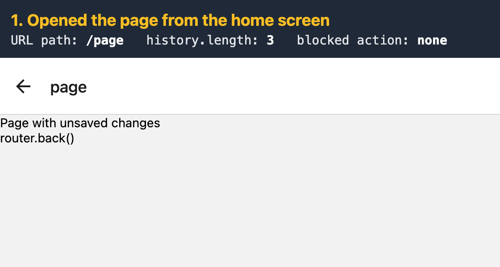
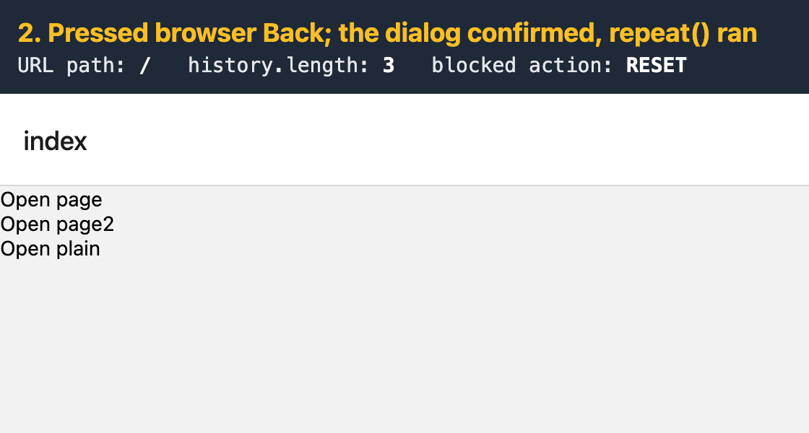
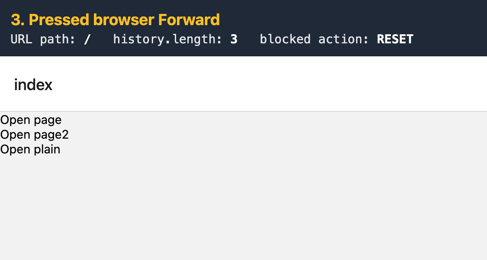
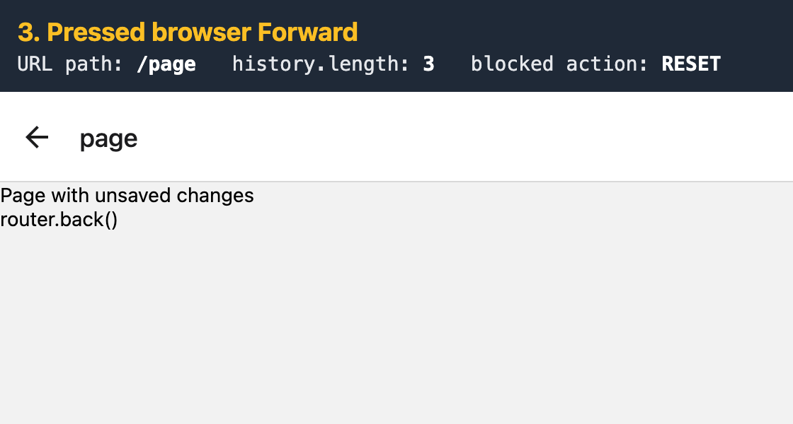

# usePreventRemove: repeat() after a blocked browser Back replaces the history entry

Reproduction and proposed fix for https://github.com/expo/expo/issues/53441 (web).

Versions: Expo SDK 58, `expo` 58.0.25, `expo-router` 58.0.31, `react-native-web` 0.21.4, Chrome.

| Before: Forward does nothing, the browser stays on `/` | After the fix: Forward reopens `/page` |
| --- | --- |
|  |  |

The dark bar at the top is part of the test app. It shows the step, the URL path, `history.length` and
the action `usePreventRemove` blocked.

## Run

```sh
npm install
npm run web            # expo start --web --port 8099
```

By hand: open http://localhost:8099, click **Open page**, press the browser **Back** button, then
press **Forward**. Or, with Chrome installed, in a second terminal:

```sh
npm run trace -- http://localhost:8099 before   # headless Chrome; prints history + commands, saves media/before-*.png
```

## Steps, expected, actual

The app is a root `<Stack />`, a home screen with a `Link` to `/page`, and `/page` with
`usePreventRemove(true, ...)`. The callback stands in for a "Discard changes?" dialog the user
confirms: it records `data.action.type` and calls `repeat()`.

1. Open `/`, click **Open page**. URL `/page`, browser history `[/, /page]`.
2. Press browser **Back**. `usePreventRemove` blocks it, the callback calls `repeat()`.
3. Press browser **Forward**.

**Expected:** after step 2 the browser sits on `/` with `/page` as the forward entry, so step 3
reopens `/page`. That is what happens when the page leaves through `router.back()` instead.

**Actual:** the blocked action is `RESET`. After `repeat()` the screen shows `/`, but the browser
stays on the second entry and its URL is replaced with `/`. History becomes `[/, /]`, Forward
does nothing, and `/page` can no longer be reached through the history.

| Step | Before | After the fix |
| --- | --- | --- |
| 1. Opened the page |  |  |
| 2. Browser Back, dialog confirmed, `repeat()` |  |  |
| 3. Browser Forward |  |  |

## What the browser does (recorded)

`media/trace-before.txt`, from `npm run trace`. The indented lines are the `history` calls Expo
Router made, logged by the app, and the `popstate` events (Chrome, `Page.getNavigationHistory`,
the initial `about:blank` entry left out):

```
browser Back, usePreventRemove + repeat():
  after Link             {"path":"/page","blocked":null,"history":["/","/page"],"index":1}
         pushState({"id":"…:1"}, /page)
  after leaving          {"path":"/","blocked":"RESET","history":["/","/"],"index":1}
         popstate state={"id":"…:0"}                       browser Back landed on entry 0
         history.go(1)                                      prevented: router moves the browser forward again
         popstate state={"id":"…:1"}
         replaceState({"id":"…:1"}, /)                      repeat(): entry 1's URL is overwritten with /
  after browser Forward  {"path":"/","blocked":"RESET","history":["/","/"],"index":1}
```

With the fix (`media/trace-after.txt`) the replay moves the browser instead of overwriting the entry:

```
  after leaving          {"path":"/","blocked":"RESET","history":["/","/page"],"index":0}
         popstate state={"id":"…:0"}
         history.go(1)
         popstate state={"id":"…:1"}
         history.go(-1)                                     repeat(): back to the entry the user chose
         popstate state={"id":"…:0"}
         replaceState({"id":"…:0"}, /)
  after browser Forward  {"path":"/page","blocked":"RESET","history":["/","/page"],"index":1}
```

## Controls

| Page | Leaves by | History after leaving (58.0.31) | Forward |
| --- | --- | --- | --- |
| `/page`, hook + `repeat()` | browser Back | `[/, /]`, index 1 | **stays on `/`** |
| `/page`, hook + `repeat()` | `router.back()` | `[/, /page]`, index 0 | `/page` |
| `/page2`, hook, `preventRemove` set to `false` before `repeat()` | browser Back | `[/, /]`, index 1 | **stays on `/`** |
| `/plain`, no hook | browser Back | `[/, /plain]`, index 0 | `/plain` |

Browser Back is fine without the hook and fine when the page leaves through the router. Only
`repeat()` after a blocked browser Back corrupts the history, and clearing `preventRemove` first
(as the runtime warning asks) does not change it.

## Cause

`packages/expo-router/src/global-state/browserHistory.ts`. On `popstate`, `restoreTrackedEntry`
reduces a `RESET` to the entry's saved state, targeted at the **root** navigator. When a screen
prevents it, the router moves the browser forward again (`history.go(1)`) and `usePreventRemove`
hands that `RESET` to its callback. `repeat()` dispatches it as an ordinary action. The root
navigator's router reports no history traversal for it, because only the nested layout Stack's
index changed, so `applyRouterHistoryAction` falls through to `selectAndUpdateHistoryEntry` for
the **current** entry and overwrites its URL with `/`.

Confirmed by logging the reducer: the replayed action is `RESET target=navigator:root` with
`browserHistoryAction=undefined`, while `history.index` is still 1.

## Fix

`fix/expo-router-53441.patch` (against `expo/expo` main, branch
`fix/router-prevent-remove-browser-restore`):

- `restoreTrackedEntry` creates the `RESET` with the tracked entry's ID (`browserHistoryEntryId`).
- New `applyReplayedRestore(history, nextState, config, action)`: for a `RESET` that carries an
  entry ID still in the tracked history, it reuses `selectAndUpdateHistoryEntry` for that entry,
  which emits `go(delta)` to the entry the user chose plus the usual `replace`. It returns
  `undefined` for other actions and for an entry that later navigation discarded, so the reducer
  falls back to the router's instruction.
- `reduceOperation` in `useNavigationTreeReducer.ts` tries `applyReplayedRestore` for `ACTION`
  operations before `applyRouterHistoryAction`.

Because the move targets the entry by ID, it also works when the user jumped several entries from
the browser's history menu, and for a blocked Forward.

Apply the same change to the installed `expo-router` build to check it here:

```sh
npm run fix          # patches node_modules/expo-router/build (keeps .orig copies)
npm run fix:revert
```

## Tests

In the patch, for `packages/expo-router`:

- `browserHistory.test.web.tsx`: the tracked restore carries `browserHistoryEntryId`; replaying it
  moves the browser to the restored entry; a replay whose entry is gone, and a plain `RESET`, are
  left to the router.
- `useNavigationTreeReducer.test.web.tsx`: a root navigator holding a layout Stack (the shape of a
  real app) replays a prevented browser Back as `go(-1)` + `replace`.

Run against the published build in this repo (`npm test`): fails on 58.0.31, passes after
`npm run fix`. The existing upstream tests for both files pass against the patched build, except
one that depends on a change not in 58.0.31 and fails the same way without the patch.

## Files

- `app/` the three screens plus `page2` and `plain` controls; `components/HistoryStatus.tsx` the
  status bar; `app/_layout.tsx` also logs the history calls.
- `scripts/history.mjs` drives Chrome; `scripts/make-media.mjs` builds the GIFs and the
  side-by-side PNG from the screenshots; `scripts/apply-fix.mjs` patches the installed build.
- `media/` screenshots, GIFs and traces for before and after; `fix/` the patch.
