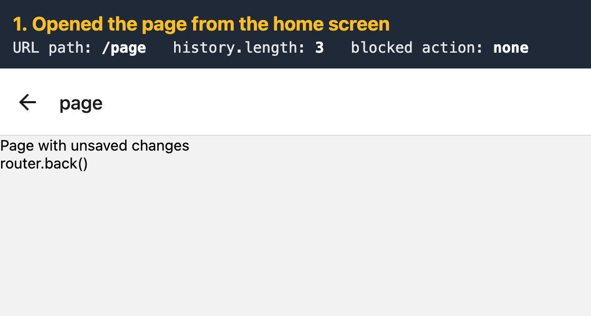
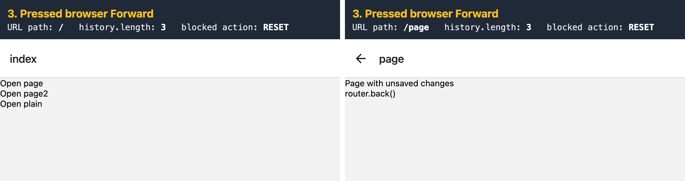

# Why

Closes https://github.com/expo/expo/issues/53441

On web, a screen with `usePreventRemove(true, ({ repeat }) => ...)` that confirms its dialog and calls `repeat()` after the browser **Back** button ends up with a corrupted history. The browser stays on the second entry and that entry's URL is replaced with the first screen's path: `[/, /page]` becomes `[/, /]`, **Forward** does nothing, and `/page` can no longer be reached through the history. Leaving the same screen through `router.back()` works.

The `popstate` restore reduces a `RESET` to the entry's saved state, targeted at the root navigator. When a screen prevents it, `restoreTrackedEntry` moves the browser forward again to the entry that matches the UI, and `usePreventRemove` hands that `RESET` to its callback. `repeat()` dispatches it as an ordinary action. The root navigator's router reports no traversal for it, since only the nested layout stack's index changes, so `applyRouterHistoryAction` falls through to refreshing the current entry and overwrites its URL. Confirmed by logging the reducer in the repro app: `RESET target=navigator:root`, `browserHistoryAction=undefined`, `history.index=1`.

# How

`packages/expo-router/src/global-state/browserHistory.ts`

- `restoreTrackedEntry` creates the `RESET` with the tracked entry's ID in `browserHistoryEntryId`.
- New `applyReplayedRestore(history, nextState, config, action)`. For a `RESET` that carries an entry ID still in the tracked history it reuses `selectAndUpdateHistoryEntry` for that entry, so the browser gets `go(delta)` to the entry the user chose, followed by the usual `replace`. It returns `undefined` for other actions and for an entry that later navigation discarded, and the reducer then falls back to the router's instruction as before.

`useNavigationTreeReducer.ts`

- `reduceOperation` tries `applyReplayedRestore` for `ACTION` operations before `applyRouterHistoryAction`. Structural repairs keep their existing path.

Moving by entry ID also covers a jump of several entries from the browser's history menu and a blocked **Forward**, which `router.back()` as a workaround does not.

# Test Plan

- Jest, `browserHistory.test.web.tsx`: the restore of a tracked entry carries `browserHistoryEntryId`; replaying it moves the browser to the restored entry (`go(-1)` + `replace`); a replay whose entry is gone, and a plain `RESET`, are left to the router.
- Jest, `useNavigationTreeReducer.test.web.tsx`: a root navigator holding a layout stack, the shape of an app, replays a prevented browser Back as `go(-1)` + `replace`. Fails without the change (only a `replace`), passes with it.
- The same two test files run against the published `expo-router` 58.0.31 build with the change applied to it: 47 of 48 pass; the one failure is `replaces the current entry when required screens are synced below the focused route`, which depends on a `main` change not in 58.0.31 and fails the same way without this patch. `tsc` and `oxfmt` clean for the changed files.
- Headless Chrome, `expo-router` 58.0.31 with and without the change applied to the installed build, reading `Page.getNavigationHistory` after each step and logging the app's `history` calls. Reproduction, screenshots, GIFs, traces and scripts: https://github.com/dileepapeiris/expo-router-preventremove-browser-back-repro

| Step | Before | After |
|---|---|---|
| Link to `/page` | `[/, /page]`, index 1 | same |
| Browser Back, `repeat()` | `history.go(1)` then `replaceState(entry 1, /)` → `[/, /]`, index 1 | `history.go(1)`, `history.go(-1)`, `replaceState(entry 0, /)` → `[/, /page]`, index 0 |
| Browser Forward | stays on `/` | `/page` |

Controls unchanged: `router.back()` from the same screen, a screen without the hook, and a screen that sets `preventRemove` to `false` before `repeat()` (which also failed before).

| Before: Forward does nothing | After: Forward reopens `/page` |
|---|---|
|  |  |

| Forward pressed, before and after |
|---|
|  |

# Checklist

- [x] I added a `changeset` for user-facing changes to published packages (see [.changeset/README.md](https://github.com/expo/expo/blob/main/.changeset/README.md)).
- [x] This diff will work correctly for `npx expo prebuild` & EAS Build (eg: updated a module plugin).
- [x] Conforms with the [Documentation Writing Style Guide](https://github.com/expo/expo/blob/main/guides/Expo%20Documentation%20Writing%20Style%20Guide.md)
